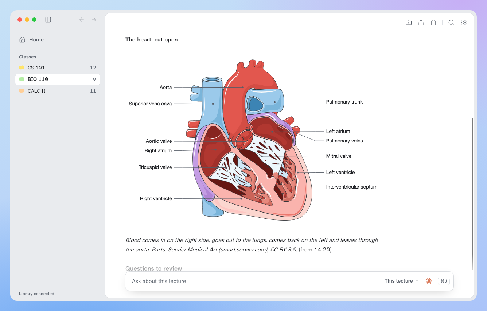
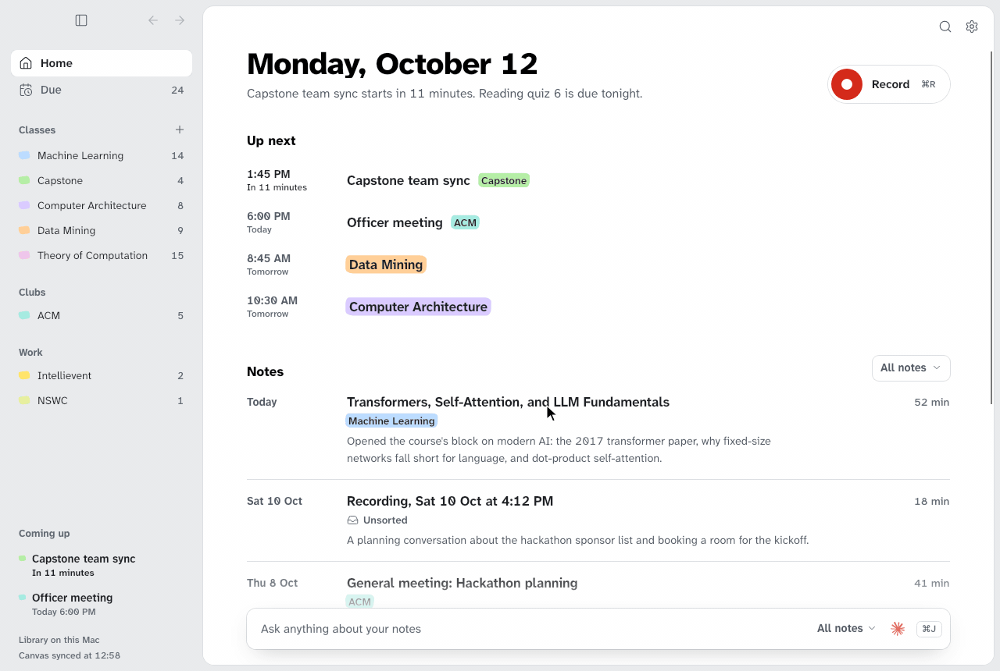
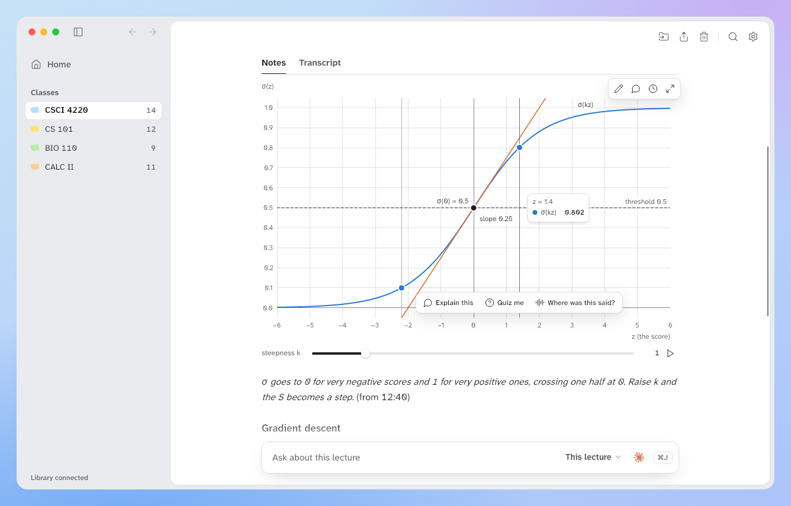
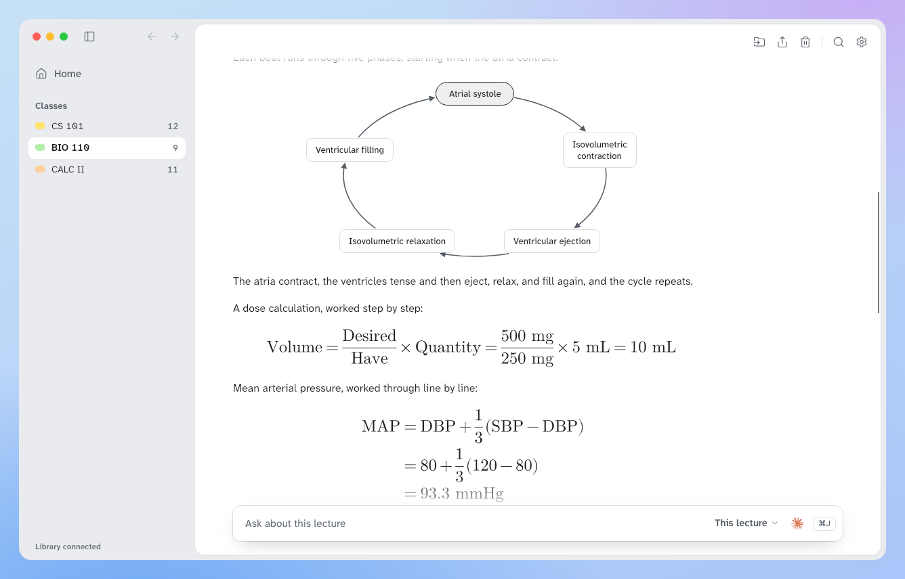
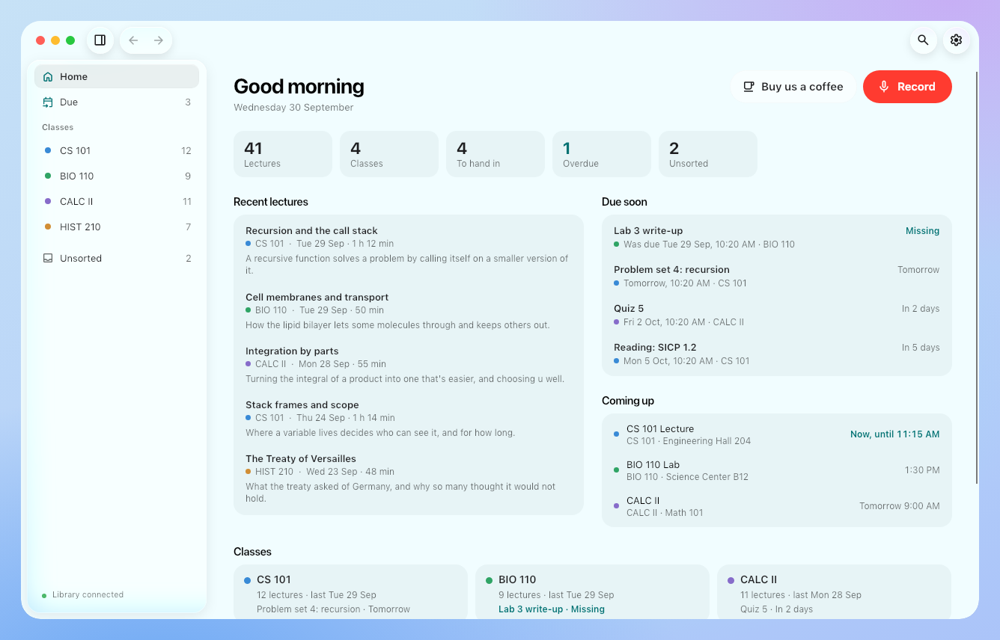
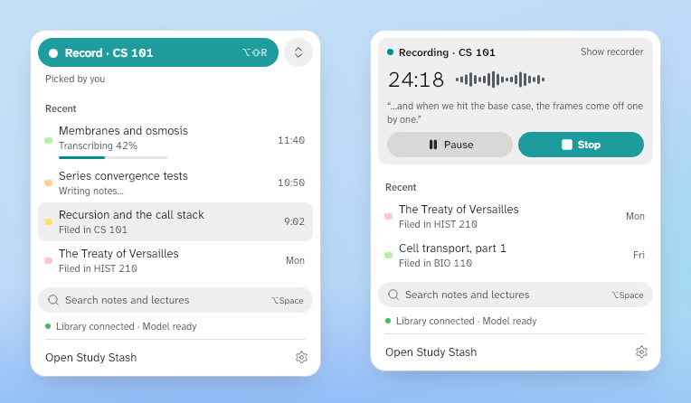
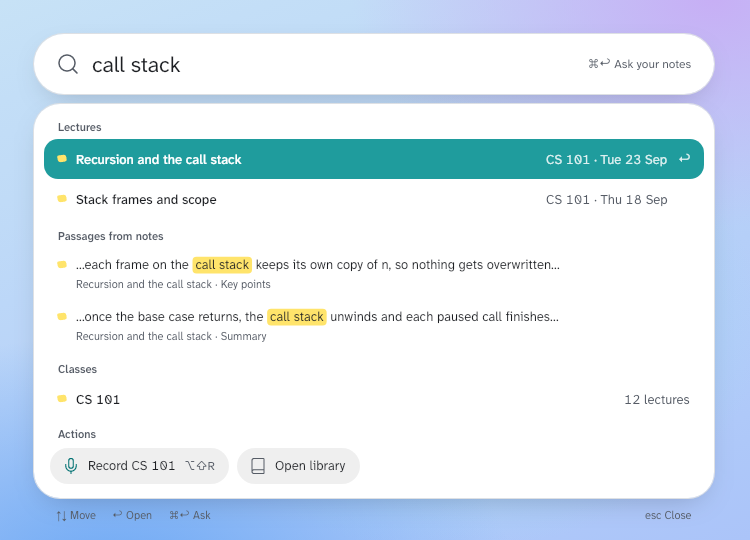
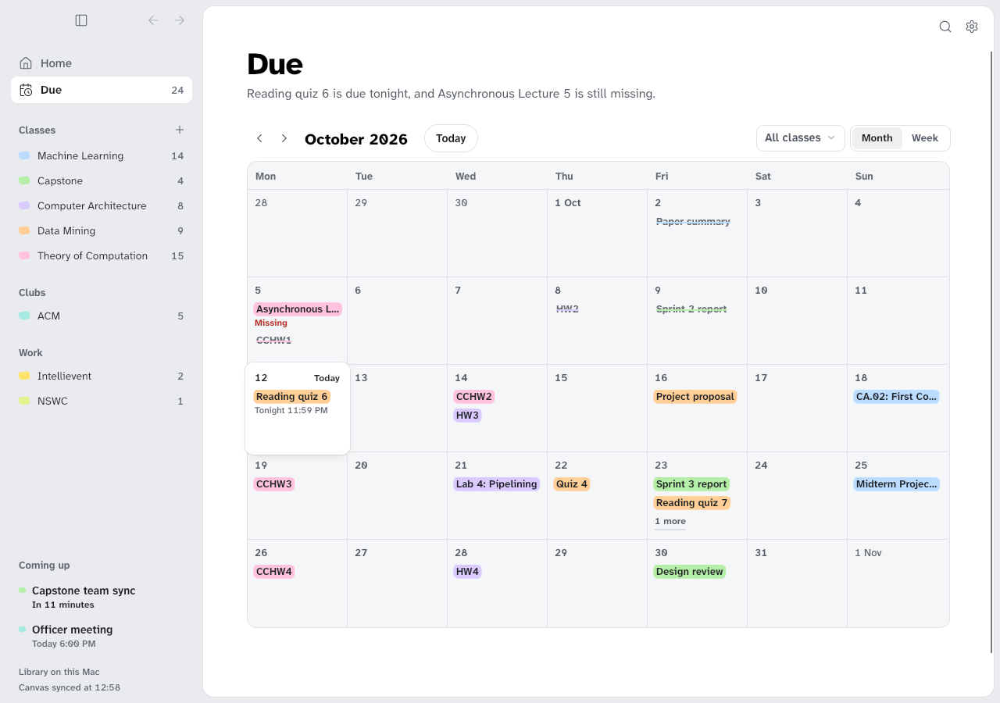

<p align="center"></p>

<h1 align="center">Syft Notes</h1>

<p align="center">
  <b>Syft Notes is a free, open-source AI lecture recorder and note-taker for students on Mac, Windows and Linux: it records your lectures, transcribes them on your own computer and writes study notes, with the diagrams already drawn.</b><br>
  Works with Claude, ChatGPT, Gemini or a free AI on your computer. No paid plan needed, and your recordings stay on your own computers.
</p>

<p align="center">
  <a href="https://github.com/Joseph-Rus/study-stash/releases/latest/download/Syft-Notes.dmg"><b>Download for Mac</b></a>
  &nbsp;·&nbsp;
  <a href="https://github.com/Joseph-Rus/study-stash/releases/latest/download/Syft-Notes-Setup.exe"><b>Download for Windows</b></a>
  &nbsp;·&nbsp;
  <a href="#install"><b>Linux</b></a>
  &nbsp;·&nbsp;
  <a href="https://syftnotes.com">Website</a>
</p>

<p align="center">
  <a href="https://github.com/Joseph-Rus/study-stash/releases/latest"></a>
  
  <a href="LICENSE"></a>
</p>

<picture>
  <source media="(prefers-color-scheme: dark)" srcset="docs/images/notes-heart-dark.png">
  
</picture>

Press Record when the lecture starts. It's written down as it goes, on your computer, and when you
stop, the notes are written, filed under the right class next to your Canvas assignments, and ready
to ask about. Two students build it, with Claude.

Syft Notes is an open-source alternative to Otter.ai, Granola and Notability for recording
lectures: it's free, transcribes on your own computer, and writes notes with whichever AI you
choose, including a free one that runs on your machine.

## What it does

- **Records lectures** from the menu bar (Mac) or the tray (Windows and Linux), with one click or one shortcut.
- **Transcribes them on your computer** with Whisper or NVIDIA Parakeet, live as the lecturer speaks.
- **Writes AI study notes** (summary, key points, definitions, review questions) with Claude, ChatGPT, Gemini or a free local AI.
- **Draws the diagrams**: flowcharts, labelled drawings, typeset formulas, and graphs worked out from the lecturer's formula.
- **Keeps your own notes**: type while it records, in Markdown if you like, and every line of yours stays in the write-up.
- **Answers questions about your lectures** from your notes and transcripts, with the moment it was said. Your chats are kept.
- **Recipes**: the questions you ask of every lecture (a study guide, what's likely on the exam, key terms) are one `/` away.
- **Hears what's on the exam**: "this will be on the midterm", "make sure you know", flagged on the lecture's page with the moment.
- **Helps you study**: flashcards from your lectures in Review, brought back just before you'd forget them, and exam prep with a study guide and a practice test.
- **Reads a lecture to you**: Listen turns it into a five-minute conversation for a walk, read by your computer's own voices.
- **Never loses a version of your notes**: Undo after any change, and History to put back any earlier one.
- **Files every lecture by class**, next to your Canvas assignments, due dates, rubrics, files and announcements.
- **Works without a paid AI**: a free AI on your computer, a free Gemini key, the free Claude app, or copy and paste with any chat.
- **Lets you select and copy almost anything**: notes, transcripts, chats, assignments, even error messages.
- **Finds anything in a second** from a quick panel, and shows what's due on a calendar.
- **Comes with you on your phone**, and lets Claude, ChatGPT and other AI apps read your library over MCP.

## Take notes while it records

Recording opens the lecture's page at once, and you can type your own notes there while it records,
as much or as little as you like. Markdown works as you type: `#` makes a heading, `-` a bullet,
`1.` a numbered list, `[ ]` a checkbox and `>` a quote, and **bold**, *italic*, `code`, links and
maths show formatted (⌘B and ⌘I, or Ctrl+B and Ctrl+I on Windows). When you stop, the write-up is
built round what you typed: every line of yours is kept, in ink and with its formatting, and what
the lecture said about it is added in grey. **Only my notes** hides what was added.



## AI study notes with diagrams

Once a lecture's notes are written, a second pass reads the transcript and decides whether anything
in it is clearer as a picture. If something is, it's drawn into the notes under the section it
belongs to, with the moment of the lecture it came from.

**Drawings you can point at.** A lecture that spends time on a physical thing (the heart cut open,
the bones of the hand, a drone, a circuit board) gets a labelled drawing of it, like a figure in a
textbook. That's the heart above. Most are put together in seconds from about 300 professionally
drawn, openly licensed parts. Point at a part and it lights up. Click it for the line where the
lecturer named it, or hide every label and test yourself.

**Graphs worked out from the formula.** When the shape of a formula is the point (a sigmoid, a loss
curve, a distribution), the notes plot it. The AI only writes down the formula the lecturer gave and
the app does the maths, so a curve is never sketched freehand. Drag a slider and it redraws. Read any
value under the pointer, or hide the curve with **Predict** and sketch it yourself first.

<picture>
  <source media="(prefers-color-scheme: dark)" srcset="docs/images/notes-plot-dark.png">
  
</picture>

**Formulas and diagrams, typeset.** Formulas look the way you'd write them on paper. A process or a
cycle comes back as a diagram you can walk through a box at a time, and every box has **Explain
this**, **Quiz me** and **Where was this said?**, which opens the transcript at the line that says it.

<picture>
  <source media="(prefers-color-scheme: dark)" srcset="docs/images/notes-formulas-dark.png">
  
</picture>

## Ask questions about your lectures

The Ask bar under a lecture's notes answers from your notes and transcripts, with the AI you pick
for that question. Ask about one lecture, a whole class, or all of them. The times under an answer
open the transcript at the line where it was said, and a question asked while a lecture is still
recording is answered from that recording.

Your chats are kept. A lecture's page opens on its latest chat, so you can pick up where you left
off, even after closing Syft Notes, and follow-ups like "and the second one?" or "explain that more
simply" know what was just said. **Chats**, at the top of the Ask card and in the ask bar, lists your
past conversations; **New chat** starts a fresh one, and a chat can be renamed, or deleted with
Undo. A folder's page lists its own chats and its lectures', and Home lists them all. Chats are kept
on your library, so your laptop sees them too.

The quick panel (⌥Space on a Mac, Alt+Shift+Space on Windows) opens over any app. It searches
lectures, passages in your notes and classes, and asks your notes a question.

**Recipes** keep the questions you ask of every lecture one `/` away. Type `/` in the Ask bar and the
recipes show over it (Tab takes the first), or press the bookmark beside the bar for the list: a study
guide, what's likely on the exam, explain it simply, key terms, practice questions, five bullets, how
it connects, what's tricky. Anything typed after one (`/study-guide just chapter 3`) goes with it. A
question in the bar can be kept as a recipe of your own, and every device that asks your library has
them.

## Study: Review, exam prep and Listen

**What's on the exam.** A lecture's page lists what the lecturer said would be on the exam ("this will
be on the midterm", "make sure you know this", "write this down"), each with its moment, and what they
said won't be. It's found in the transcript on your computer, with no AI.

**Review.** Make review cards on a lecture's page has your AI write a dozen flashcards from its notes
and what was flagged for the exam. **Study**, in the sidebar with how many are due, goes through them a
card at a time: the question, then the answer (Space), then Again, Hard, Good or Easy (1 to 4). Each
comes back just before you'd forget it, the way Anki spaces them: Again in ten minutes, Good tomorrow,
then further apart each time you remember it.

**Exam prep.** Study lists the exams coming up, from Canvas and your calendar. Prep for it writes a
study guide and a practice test from the class's lectures since the exam before it, starting with what
the lecturer said would be on it. The test marks each answer, keeps your score, and puts what you
missed into Review.

**Listen.** Listen on a lecture's page turns it into a five-minute conversation, a tutor and a
classmate going over what was taught, read by your computer's own voices (on Linux, install
`espeak-ng`). It plays on the page, so you can go over a lecture on a walk.

See [docs/study-tools.md](docs/study-tools.md) for how each works and its API.

## Edit, undo and copy your notes

**Edit** turns a lecture's notes into their Markdown, with each diagram, plot and drawing folded to
one line of its own, and **Save** (⌘S, or Ctrl+S on Windows) keeps your changes. **Rewrite notes
with** has another AI write them again, and you keep whichever you like.

Every change to a lecture's notes is kept: notes your AI wrote, a rewrite, your own edits, notes
pasted in. Right after a change, **Undo** appears over the notes (⌘Z, or Ctrl+Z on Windows).
**History**, in the notes' header, lists every version ("Written by Claude", "Your edit"), shows
what each would change, and puts any of them back.

Drag across the notes to select them, as on a web page: from one paragraph into the next, through
bullets, tables and formulas. Copy with ⌘C (Ctrl+C) or right-click and choose Copy. What you copy
keeps its shape: each bullet keeps its "• ", a table's cells paste into a spreadsheet, and a formula
comes out as LaTeX. Transcripts (each line keeps its time), chats, the recorder's live words,
assignments, Canvas pages and announcements select the same way, and so do error messages,
addresses and codes, so you can paste them when you need help.

## Filed by class, with what's coming up

Every lecture is filed under its class, worked out from what was said, or the class you picked. One
it can't place stays on Home as Unsorted, where the folder under its title moves it in a click (with
Undo), and a lecture you don't need can be deleted (with Undo).

The library opens on **Home**: the date, a sentence on what's pressing, **Up next** (click an event
to record it) and every note, newest first. Each folder, a class, a club or work, has one page: its
notes by week, and beside them what's due, its lists on Canvas and when it next meets.

Paste your calendar's link (Google's secret iCal address, iCloud, Outlook or your school's) in
**Settings → Calendars** and pick which calendars to share. Upcoming classes show in the menu bar,
the quick panel and the library, and a lecture recorded during one is named after it and filed under
its class. When a recurring event looks like one of your classes, Syft Notes offers to file every
one of them there.

Attach iPad handwriting, slides, PDFs or photos to a lecture or class (drag them in). Their words,
handwriting included, are read on your computer and go into the lecture's notes, Ask and Claude.

Not just for school: setup asks what you'll use Syft Notes for (school, work, research, creative
work or personal). Without school there's no Canvas step, classes are called folders, and notes are
written for meetings and talks: a summary, decisions, action items with who and when, and open
questions. Change it any time in Settings → General.

<picture>
  <source media="(prefers-color-scheme: dark)" srcset="docs/images/home-dark.png">
  
</picture>

<p align="center">
  
  
</p>

Easy to read: black, grey and white, in a typeface made to be legible (Atkinson Hyperlegible Next),
with each class's highlighter the one colour. Light and dark, on a Mac and on Windows.

## FAQ

### Is Syft Notes free?

Yes. It's free and open source under the MIT licence, with no account to make and nothing to
subscribe to. If you already pay for Claude or ChatGPT it can use that plan, but it doesn't need one.

### Does it work offline? Are my recordings private?

Recording and transcribing work offline once the speech model is downloaded, and the audio never
leaves your computer. Notes from the free AI on your computer stay there too; with Claude, ChatGPT
or Gemini, a lecture's transcript goes to that AI under your own account (see [Privacy](#privacy)).

### Which AI does it use?

The one you pick: Claude, ChatGPT or Gemini, with the plan or API key you have, or a free AI that
runs on your own computer (Ollama). You can use one for notes and another for questions, and change
it any time in **Settings → Your AI**.

### Do I need a paid ChatGPT or Claude plan?

No. Without any AI it still records, transcribes and files your lectures, and for notes you can use
the free AI on your computer, a free Gemini API key, or the free Claude app, which saves the notes
you ask it for straight into Syft Notes. Any free chat works too: press **Copy for your AI** on a
lecture, paste it into ChatGPT, Claude or Gemini, and bring back what it writes with **Paste notes**.

### Does it work with Canvas?

Yes. A browser extension for Chrome, Edge, Brave, Firefox and the browsers built on them reads
Canvas with your own sign-in (read-only) and brings in what's due, assignments with rubrics, your
feedback, files, pages and announcements. See [Canvas](#canvas-assignments-due-dates-and-files).

### Is there an iPhone app?

Your library serves a phone app you can use today on an iPhone, iPad or Android phone over
Tailscale: read your notes, see what's due, search and add photos. A native iPhone and iPad app that
also records is in [`ios/`](ios/), and isn't on the App Store yet. See
[On your phone](#on-your-phone).

## One computer or two

Syft Notes is one app with two jobs, so you can use it the way that suits you:

- **One computer.** Your laptop records, keeps the library and writes the notes itself. Nothing
  else to set up. Notes are written while it's on.
- **A laptop and a library.** Your laptop records; a computer that stays on at home (a Mac mini,
  an old laptop, any Mac or PC) keeps the library, writes the notes and syncs Canvas, even while
  your laptop is asleep. The laptop reaches it at home or, anywhere, over
  [Tailscale](https://tailscale.com).

```
your laptop                                  your library (this laptop, or a computer at home)
┌────────────────────────────┐   lectures   ┌──────────────────────────────────────────────┐
│ record → Whisper (local)   │ ───────────▶ │ study notes (your AI) → filed under its class │
│ ask, search, Canvas, notes │ ◀─────────── │ Canvas mirror · Claude/MCP · search           │
└────────────────────────────┘              └──────────────────────────────────────────────┘
```

## Install

One download for every computer, on the [latest release](https://github.com/Joseph-Rus/study-stash/releases/latest):

| Mac | Windows | Linux |
|---|---|---|
| [Syft-Notes.dmg](https://github.com/Joseph-Rus/study-stash/releases/latest/download/Syft-Notes.dmg) | [Syft-Notes-Setup.exe](https://github.com/Joseph-Rus/study-stash/releases/latest/download/Syft-Notes-Setup.exe) | [x64](https://github.com/Joseph-Rus/study-stash/releases/latest/download/Syft-Notes-linux-x64.tar.gz) · [ARM64](https://github.com/Joseph-Rus/study-stash/releases/latest/download/Syft-Notes-linux-arm64.tar.gz) |

It's the same app every way; what a computer is for is chosen when you first open it, not when
you download it. The Mac app needs macOS 15 (Sequoia) or later, on Apple silicon or Intel; the
Windows one, Windows 10 or 11; the Linux one, a desktop with PipeWire or PulseAudio (Ubuntu 22.04 or
later, Fedora, Debian 12, Mint, and the like), on x64 or ARM64.

- **Mac:** open the DMG and drag **Syft Notes** into Applications. It's signed with a Developer ID
  and notarized by Apple, so it opens like any app from the internet (macOS asks once whether to
  open it). Allow the microphone when it asks.
- **Windows:** run the Setup.exe. It installs for your account only, no admin rights needed. If
  Windows says "Windows protected your PC", click **More info**, then **Run anyway**.
- **Linux:** unpack the tarball and run its `install.sh` (`tar -xzf Syft-Notes-linux-x64.tar.gz &&
  sh syft-notes/install.sh`). It installs for your account only, no root needed: the app in
  `~/.local/share/syft-notes`, **Syft Notes** in your applications menu, and `syft-notes` on your
  PATH. It looks like the Windows app and lives in your desktop's tray (on GNOME, the AppIndicator
  extension shows it; Ubuntu has it already). The shortcuts work on X11; Wayland doesn't let an app
  have keys of its own, so there you record and search from the tray, or give the keys to Syft Notes
  in your desktop's keyboard settings.

Or install from a terminal:

```bash
# Mac or Linux (Terminal)
curl -fsSL https://raw.githubusercontent.com/Joseph-Rus/study-stash/main/install.sh | sh
```
```powershell
# Windows (PowerShell)
irm https://raw.githubusercontent.com/Joseph-Rus/study-stash/main/install.ps1 | iex
```

Then open **Syft Notes**. See [Setting up](#setting-up).

## Setting up

The first time Syft Notes opens, it says how it works, then asks which AI you have. An AI sets
Syft Notes up with you, writes your notes and answers your questions:

- **Claude**: you have a paid Claude plan, Pro or Max. (Syft Notes talks to it through Claude Code,
  Anthropic's own helper for apps.)
- **ChatGPT**: you have a paid ChatGPT plan, Plus or higher. (Through Codex, OpenAI's.)
- **Gemini**: you connect it on the notes step, with an API key or Google's Antigravity app.
- **I don't have a paid plan**: that's fine. Syft Notes still records and transcribes. A free AI on
  your computer (Ollama) or an API key is there too, marked Advanced.

**If you already have the ChatGPT app or the Claude app on a Mac, there's nothing to install.** The
ChatGPT app carries Codex inside it, signed in with the app, and the Claude app keeps its own Claude
Code once its Code tab has been opened. Syft Notes finds those copies: the one you have starts
picked, and **Continue** goes straight to the chat.

Otherwise: pick the one you pay for, press **Download and set up** (Syft Notes runs its maker's own
installer, for your account only, no admin password; nothing is downloaded until you press it), then
**Open sign-in page** to sign in on Claude's or ChatGPT's own page. Syft Notes never sees your
password or your sign-in. A tiny test message then checks your plan includes it. If the account is
on a plan other apps can't use (a free one), setup says so, and you can carry on and add an API key
on the notes step.

After that your AI walks you through the rest in a chat, with a checklist beside it: one computer or
two, the microphone, the transcription model, your classes, Canvas, letting your ChatGPT or Claude
app read your lectures (one **Connect**, if you have the app), and starting at login. It can
only use Syft Notes' own setup tools (no commands, files or web), and anything that changes your
computer happens only when you press the button in its card. Close the window part-way and the chat
picks up where it left off. The chat uses a little of your plan, and your AI then writes your
notes and answers your questions (you can switch to a free local model in Settings any time).

Choosing Gemini or **I don't have a paid plan**, or pressing **Set up by hand**, goes to setup by
hand: a few plain steps. It asks **Where your lectures are kept**, with **Just this Mac** (or **Just this PC**) chosen, which is what
most students want: check the microphone, choose who writes the notes, what you'll use Syft Notes
for, Canvas, your classes, and starting at login (recommended, so your library runs whenever you're
logged in). There's no step for the speech model: Syft Notes picks one that keeps up on your
computer and downloads it while you finish.

The notes step lists **Free AI on this Mac** (marked **Advanced**), **Claude** and **ChatGPT**, each
with one button, **Set it up**, and **Gemini**. Claude, ChatGPT and Gemini can each use an API key
pasted there instead. **No AI for now** records and transcribes, and notes can be switched on later
in Settings. With no paid plan the step starts on the free AI if it's already on your computer with
a model, and on **No AI for now** otherwise. The free AI's **Set it up** downloads Ollama with a
model sized for your computer, installs and starts it, and shows how far along it is, with nothing to
do in a browser or a terminal; you can carry on with setup while it downloads. Setup tries the AI you
pick once before saving it, so a signed-out one is caught right there. **Set up by hand** is on
every screen too, and **Settings → General → Run setup** runs either again.

Under **Advanced**, for a laptop you take to class and a computer at home that stays on:

- **My computer at home:** a password for your library, who writes the notes, what it's for,
  Canvas, your classes, and starting at login. It ends by showing the address and password to
  connect a laptop.
- **My laptop for class:** find your library (or type its address and password), check the
  microphone, what it's for, Canvas, and your classes.

Changed your mind, or your plans changed? Switch any time in **Settings → Connection → This
computer**: a laptop can also become your library (bringing over whatever it was connected to
before), and a library can become a laptop, sending its own lectures to the new one first so
nothing is left behind. Nothing to reinstall or redownload.

## Record and transcribe lectures

Click **Record** in the menu bar (Mac) or tray (Windows and Linux), press ⌥⇧R (Ctrl+Alt+R on Windows and Linux), or
click an event in **Up next**. Syft Notes transcribes as you go, so the recorder shows what's said
and you can ask about it mid-lecture; or, to save battery, it only records during the lecture and
transcribes it after class (Settings → Recording). The audio never leaves your computer.

**The model.** Setup picks one for you and doesn't ask: one that keeps up with a lecture on your
computer and stays light. On most computers that's Whisper large-v3 turbo in its compact form
(574 MB, about 0.8 GB of memory while you record), on the graphics where there are any (Metal on a
Mac with Apple silicon, Vulkan on a PC with a graphics card). A computer too slow for it gets a
lighter Whisper (small or base), or, on an ARM computer, Cactus Whistle, which comes with the app.
**Settings → Recording** has the others: Whisper large-v3 and large-v3 turbo, more accurate and
heavier, and NVIDIA's Parakeet v3 (a 2.5 GB download that holds about 3 GB of memory), which makes
the fewest mistakes in English and most European languages, runs well on the processor alone and
never makes up words over silence. Parakeet reads 25 European languages; a lecture in another
language uses Whisper. On a Mac with Apple silicon or a PC with an ARM processor, Cactus Whistle is
there too: the fastest and smallest, about as accurate as Whisper base. Each downloaded model you
aren't using has its own **Remove**, to free the space.

**The live words.** Whatever the model, while a lecture is transcribed as you go, the open recorder
shows what's said a second or two after it's said: a quick model hears the newest sound every
second, and the chosen model's more accurate lines take its place as they come (about half a minute
behind). The quick model comes with the app: Cactus Whistle on Apple silicon and Windows on ARM,
where its engine is fastest; a small Whisper (tiny, 44 MB) on Intel Macs, other PCs and Linux, where
Whistle's engine is slow or has no build. Every pass is timed, and each lecture's first is a short test: where this
computer can't keep up cheaply during a lecture (a pass taking more than 0.3× the sound it hears),
the live words switch themselves off for that lecture and the recorder shows the chosen model's
lines only; the next lecture tries again. Whistle reads English, German, French, Spanish, Italian,
Dutch and Polish; on a computer that hears the live words with it, a lecture in another language
shows the chosen model's lines only.

**Speakers.** In Settings → Recording, an experimental **Tell speakers apart** also marks in a
transcript ("Speaker 2:") where a voice other than the lecturer's seems to speak; it is careful
rather than complete, and can be wrong.

**While it records**, the lecture's page has the recording's bar across its top: the level, the
time, Pause and Stop. When the library window isn't the one in front, a small white pill floats on
screen instead: its red dot is Stop, then the class, the level and the time. Pause and stop from the
menu bar too.

## Your AI: Claude, ChatGPT, Gemini or Ollama

Pick who writes your notes and who answers your questions in setup or in **Settings → Your AI**:
one AI for everything, or a different one for each job. The same page switches the rich notes
(below) and sets how fast Claude Code works. The AI runs on your library's computer (with one
computer, that's your laptop). Without one, lectures are still filed and keep their transcripts.
With Claude, ChatGPT or Gemini, a lecture's transcript (and, for its diagrams, its notes) goes to
that AI under your own account; with Ollama nothing leaves your computer.

**In setup, each one is a button.** Setup's notes step lists **Free AI on this Mac**, **Claude** and
**ChatGPT**, each with **Set it up**, and **Gemini**, whose button is its API key. The free one
downloads Ollama and a model that fits your computer's memory (about 1.4 GB on a small laptop,
10 GB on one with 14 GB of memory or more, 24 GB on a big machine), installs and starts it, and says
first if the disk has no room; a model that's already installed is used instead. Claude and ChatGPT
get their maker's own installer and their own sign-in page. Nothing is typed into a terminal. The
commands below are for doing it yourself, or on a library you set up another way.

**Ollama**: free, and nothing leaves your computer. Install it from [ollama.com](https://ollama.com),
and Syft Notes offers to download a model.

**Claude** (through Claude Code): uses your Claude plan. Install it, then run `claude` once in
Terminal and sign in:

```bash
curl -fsSL https://claude.ai/install.sh | bash      # Mac (or: brew install --cask claude-code)
```
```powershell
irm https://claude.ai/install.ps1 | iex             # Windows (PowerShell)
```

**ChatGPT** (through Codex): uses your ChatGPT plan. Install it, then run `codex login` and choose
**Sign in with ChatGPT**:

```bash
npm install -g @openai/codex                        # Mac or Windows (or on a Mac: brew install --cask codex)
```

**Gemini**: an API key, or Google's Antigravity app. A key from
[Google AI Studio](https://aistudio.google.com/apikey) needs nothing installed and has a free tier:
it uses Gemini 3.8 Flash, and Gemini 3.5 Flash-Lite once Flash's free daily limit is used up. A free
key needs a personal Google account (school accounts may not get the free tier), and you need to be
18 or over. Google's free tier may use what you send to improve its products, and people may read
it; to keep lectures private, use the free AI on your computer. Or install
[Antigravity](https://antigravity.google), run `agy` once and sign in with your Google account.

**API keys for Claude and ChatGPT.** On setup's notes step or in **Settings → Your AI**, Claude can
run on a key from the [Anthropic Console](https://console.anthropic.com/settings/keys) and ChatGPT on
one from [OpenAI's platform](https://platform.openai.com/api-keys). A key is paid for as it's used,
apart from a plan. Every key stays on your computer, readable by your account only, and only goes
to its maker; once saved, only its last four characters are shown.

On a Mac, Syft Notes also uses the Codex inside the ChatGPT app and the Claude Code the Claude app
keeps, when there's no copy installed on its own: nothing to install.

Where setup can't do it with buttons (a library you reach from another computer), its notes step
shows these commands with a Copy button, opens Terminal for you, and has **Check again** to pick the
AI up once it's installed and signed in.

**Rich notes** are the diagrams, formula plots and drawings a lecture's notes get after they're
written. They're on by default. **Settings → Your AI → Rich notes** switches them off (plain notes
only, and no second call to your AI at all) or one kind at a time: **Diagrams** (flowcharts, state
and sequence diagrams, timelines, mind maps), **Formula plots** and **Drawings** (labelled figures
of what a lecture describes). A kind that's switched off is never asked of the AI, and one drawn
anyway is left out; switching off the last kind switches rich notes off. **Drawn by** (below) picks
who designs them.

Your notes never wait for them. A lecture is filed, readable in the app, on your phone and in Ask,
the moment its notes are written, and its diagrams arrive a few minutes later, put into the notes
where they go (an open lecture's byline says *Adding diagrams…* meanwhile, then *Diagrams added*;
the page stays where you're reading).

A stronger model reads the lecture's timed transcript and its notes, and decides whether the lecture
teaches anything a picture makes clearer: a process, a cycle, a pathway, a decision rule, a
hierarchy, a structure, states and what moves between them, an exchange between parties, a
timeline, a topic's themes, a comparison, or something spatial like the forces on an object. If it
does, it designs it from what the lecturer said and puts it at the end of the section it
illustrates, with a title, a caption that says what to notice, and the moment of the lecture it
comes from. It picks the kind that fits: a flowchart (a big topic as up to 36 boxes in groups, each
box carrying the lecture's numbers and conditions in smaller words), a state diagram (an automaton's
accepting states double-circled), a sequence diagram, a timeline or a mind map. When the lecturer
gave a formula whose shape is the point (a sigmoid, a loss curve, a distribution and its parameters,
how running times grow, gradient descent on a loss surface, what a matrix does to the plane), it's a
plot of it. A lecture gets one per idea worth drawing, up to four for a long one; one under about
three minutes gets none, and so does a lecture of discussion, admin or definitions.

A lecture that describes a physical thing at length (a drone's frame, motors and battery, the bones
and tendons of the hand, the heart cut open, a circuit board, a robot arm, a cell, a titration
set-up, a server rack) can also get an **illustration**: a detailed, labelled drawing of the thing
itself, like a figure in a textbook. The designer plans it (the view, where things go, and the parts
the lecturer named, each with a line from what was said). Then, most of the time, it's **composed
from ready-made parts** in seconds: Syft Notes ships a library of about 300 professionally drawn,
openly licensed parts (Servier Medical Art's hearts, organs, organelles and glassware, DBCLS's bones,
public-domain cells, Wokwi's Arduino boards and modules, and Syft Notes' own drone, robot-arm and
server-rack parts), finds the ones that fit the plan by its words, and a fast model (Claude Code's
Sonnet) answers with a small plan of which parts go where; Syft Notes draws the parts, any simple
shapes nothing in the library shows (a tendon, a wire, a white tile) and the labels itself, in the
house style. The same plan again (a class that comes back to the drone) is drawn at once from the
last one. When the library has nothing for the subject, the same engine draws it shape by shape
instead: soft flat colours by material, gentle shading, labels in columns with leader lines, sent
back once if it looks wrong. That takes 6 to 20 minutes with Claude Code's Opus, so the diagrams of
a lecture whose illustration is drawn can arrive up to 18 minutes after its notes (the notes
themselves are never held up). Either way its labels must be the lecture's words or it's left out,
and only an engine that draws well is asked (Claude, ChatGPT or Gemini, never a local Ollama model).
A lecture gets one, two for a long one. Parts under a CC BY licence are credited under the figure.

- **Automatic** (the default) uses the strongest engine that already reads your lectures (the one
  that writes your notes or answers your questions), trying Claude Code (Opus, high effort), then
  Codex (high effort), then Gemini (3.1 Pro); otherwise the biggest model Ollama runs on the
  library's computer (never an Ollama cloud model). So a lecture never goes to an AI it wasn't
  already going to.
- **An engine of your own choice** uses its strongest model; one that isn't signed in or is over
  its limit falls back to Ollama when **Use Ollama instead** is on, as the notes do.
- **Same as notes** has the notes engine draw them as it writes (flowcharts, and drawings where its
  engine draws them; never plots).

**Claude Code speed** sets how fast Claude Code writes the notes and designs the rich notes (the
engine's other jobs, sorting and answers, never change). It's the same Claude Code run as before,
told one thing more, so a library's other engines aren't touched:

- **Standard**: as it's set up. The notes use the model you picked (or Claude Code's own default),
  and the designer uses Opus at high effort.
- **Fast mode**: Claude Code's own fast mode (`claude -p --settings '{"fastMode":true}'`, for that run
  only; it needs Claude Code 2.1.205 or later). It's the same Opus (5.5) with up to 2.5 times faster
  output, so the notes and the diagrams are as deep as ever, only sooner, but it's **billed at a higher
  rate** (Claude Code's own estimate came to about twice a standard run's) and, on a Pro, Max, Team or
  Enterprise plan, **only from your Claude account's usage credits**, which must be turned on
  (Settings → Usage on claude.ai) and are used even while your plan has usage left. A Claude account
  that can't use it (no usage credits, an organization that hasn't turned it on) just runs at its
  normal speed. A notes model you picked as Sonnet or Haiku stays as picked: fast mode is Opus's.
  The composer (Sonnet) never needs it.
- **Quicker model**: Sonnet at low effort for the notes and at medium for the designer. Quicker and
  lighter on your plan than Opus, with shallower notes and diagrams (a smaller model decides less
  well what's worth drawing).

On a 3,300-character test lecture on a Mac with Claude Code 2.1.289, the notes took 29.7 s
(3,475 tokens out) in standard speed and 12.3 s (3,757) in fast mode, and the designer 26.2 s (2,476) and
6.5 s (1,533): 56 s for both, down to 19 s. Claude Code estimated the cost at $0.33 and $0.66 for the
notes, and $0.21 and $0.37 for the designer.

A diagram that doesn't draw goes back once to be fixed and is otherwise left out, as is one with
too many boxes or words the lecture never said. Each one kept is laid out at the notes' width and
looked over; one that would look wrong (too wide to read, arrows crossing, a sentence in a box, a
big chart with no groups) goes back once with what's wrong, while there's time, and its redesign is
used only when it's better. A plot is worked out at its sliders' starting values and ends, and one
that's flat, undefined, off its axes or has a slider that changes nothing goes back the same way. If
the diagrams can't be designed (the engine is busy, over its limit, or takes longer than 8 minutes,
18 with an illustration that has to be drawn), the notes stay exactly as filed. The library's log
says what was drawn and redesigned, or why nothing was.

The diagrams are designed one lecture at a time, never while notes are being written (a pass on the
library's own Ollama model steps aside for new notes and starts again after), and they survive a
restart: a pass cut off part-way runs again, three tries at most. They go in safely. If you (or an
AI in a chat) edit a lecture's note file while its diagrams are being designed, every edit is kept
and the diagrams go into its summary under their headings; a diagram whose heading has gone is left
out rather than put somewhere it doesn't belong. Notes written again (**Rewrite notes with**, or
written afresh) get diagrams of their own instead, and a second pass replaces the first one's
diagrams rather than adding more. **Rewrite notes with** goes the same way: the new notes are ready
as soon as their words are, and their diagrams follow once you use them.

## Formulas, diagrams and plots in your notes

A lecture's notes write formulas and diagrams as their own engine can, and the app draws them, in
the notes, in a quick answer and in the Ask chat:

- **Formulas** are LaTeX (`$...$` inline, `$$...$$` on their own line), typeset in the app's own
  type, light or dark. One CSharpMath can't typeset shows its plain source instead, calmly.
- **Diagrams**: a process, cycle, pathway or hierarchy comes back as a Mermaid flowchart
  (` ```mermaid `) and is drawn natively, in the theme's colours: a big one in groups, laid out as
  columns of its groups with square arrows between them. Mermaid state diagrams (automata too),
  sequence diagrams, timelines and mind maps are drawn natively as well; something spatial (a
  structure, a physics setup, a circuit) comes back as a sanitised SVG. They're designed after the
  notes by the engine that draws them (**Rich notes → Drawn by**, see
  [Your AI](#your-ai-claude-chatgpt-gemini-or-ollama)), each under a bold title with a caption and
  the moment of the lecture it comes from; rewriting a lecture's notes designs them again rather
  than adding more. Either kind opens larger on a click, and a diagram Syft Notes can't draw shows
  its source with a plain reason instead of failing.
- **Illustrations**: a drawing of a thing the lecture described has parts you can point at. The
  pointer over a part lights it (and shows its name, even with the labels off) while the rest dims;
  a click pins it with its name, its line from the lecture, **Explain this**, **Quiz me**, **Where
  was this said?** and **Zoom in**. The labels turn off and on (L), **Tour the parts** walks them in
  the order their labels are read, and **Test yourself** hides every label: name each part to
  yourself and click it to check, with a small score. Search and Ask find an illustration by its
  parts and what it says of each; the phone lists them under it, and so does the Markdown download.
- **Studying from a diagram**: on screen a flowchart is there to explore, not just look at. The
  pointer over a box lights it, its arrows and the boxes they join while the rest dims; a click pins
  it, with **Explain this** and **Quiz me** (asked in the lecture's own Ask bar) and **Where was this
  said?**, which opens the transcript at the line that says it (Back to the notes returns to the
  diagram). Arrow keys walk along the arrows, ⌘ or Ctrl and the wheel (or a pinch) zoom and a drag
  pans. **Step through** walks it a box at a time in reading order (Play, or Space and the arrow
  keys), **Test yourself** hides its words to recall, a click checks one and a small score keeps
  count, with Hide some and Practise the missed ones, and a big chart made of groups opens as an
  overview, a group at a time. A designed diagram's **From 12:34 in the lecture** opens the
  transcript where it comes from. Opened larger, the window has all of this with a toolbar, and an
  SVG drawing zooms and pans there. Paper, the PDF and the Markdown download keep the still
  picture.
- **Plots**: a formula whose shape is the point is drawn as a ` ```plot `, exactly from the formula
  itself (the AI only writes the formula as the lecturer gave it, its ranges, sliders and labels;
  the app does the maths, so a curve is never drawn freehand): curves, parametric curves, bars for a
  distribution or a recurrence, shaded probabilities with their area, tangents with their slope,
  vectors and fields, a two-variable function as a heat map with contours and gradient descent
  across it, and a 2×2 matrix's map of the plane with its eigenvectors. Each parameter gets a slider
  (with a play button that sweeps it), the pointer reads every curve's value under a crosshair and a
  click pins it (with **Explain this**, **Quiz me** and **Where was this said?**), a point that's a
  slider can be dragged (a tangent along its curve), ⌘ or Ctrl and the wheel zoom (worked out again,
  so it stays exact), a click on the legend hides a curve, and **Predict** hides the curve for you to
  sketch first, then reveals it and says how close you came. A formula on its own line in the notes
  offers **Show what this looks like**, which asks the Ask bar for it as a plot. Paper and the PDF
  show it at its sliders' starting values; the Markdown download keeps its ` ```plot ` source with
  its picture saved beside it, and the phone shows the picture.
- **Download**: a lecture's "Download as Markdown…" (or a whole class's) saves a `.md` file that
  Obsidian, Typora and VS Code all open well: formulas stay LaTeX, a Mermaid diagram is saved
  again as an SVG beside it, and an SVG diagram becomes an image link to its own sanitised file.
  "Download as PDF…" saves the notes as the app draws them, ready to print: headings, tables, typeset
  formulas and diagrams as sharp vector drawings with the text selectable, light on white whatever
  the app's look, on Letter paper where that's the local size and A4 elsewhere, with page numbers.

## Canvas: assignments, due dates and files

What's due across your classes shows as a calendar, by month or by week, with what's missing and
what's handed in. Each assignment has its instructions, rubric, your submission and feedback, beside
your classes' module files and pages, announcements, quizzes and discussions.

Syft Notes reads Canvas through your browser with your own sign-in (no Canvas password or token),
and only reads; nothing on Canvas changes. It works in Chrome and the browsers built on it (Edge,
Brave, Arc, Opera, Vivaldi), and in Firefox and the browsers built on it (Zen, LibreWolf,
Waterfox). On your library's computer:

1. **Settings → Canvas** (or the Canvas step in setup): type your school's Canvas address.
2. Click **Add to Chrome** (the button names your own browser: Add to Edge, Add to Firefox; if the
   browser you usually use can't run the extension, like Safari, Syft Notes says so and uses
   another one on your computer, or points you to Chrome when there's none).
   - **Chrome, Edge, Brave, Arc and Vivaldi:** it opens
     [Syft Notes for Canvas](https://chromewebstore.google.com/detail/study-stash-for-canvas/dfhoenhdjjbnopbepgkgjdgdnfmecjjd)
     on the Chrome Web Store. Click the blue **Add to Chrome** button (Add to Brave in Brave),
     then **Add extension**. In Edge the button says **Get extension**, and the first time Edge
     asks to allow extensions from other stores: click **Allow**. Then click the extension's
     **Syft Notes** button (it may be under the puzzle-piece Extensions button), paste the code
     Syft Notes shows, click **Connect**, then **Allow**.
   - **Opera and Chromium**, or if your school's Chrome won't add it from the store (**Can't add
     it from the store? Load it from a folder instead**): it opens that browser's extensions page
     and shows the extension's folder. Turn on **Developer mode**, click **Load unpacked**, and
     pick that folder, or drag the folder onto the Extensions page. On a Mac the folder is
     **Syft Notes → Chrome extension** in your home folder (`~/Study Stash/Chrome extension`),
     where the browser's window can see it; on Windows it's `chrome-extension` in
     `%USERPROFILE%\.study-stash`.
   - **Firefox and its family:** it opens
     [Syft Notes for Canvas](https://addons.mozilla.org/firefox/addon/study-stash-for-canvas/)
     on Mozilla's add-ons site. Click the blue **Add to Firefox** button, then **Add**. Click the
     add-on's **Syft Notes** button (it may be under the puzzle-piece Extensions button), paste
     the code Syft Notes shows, click **Connect**, then **Allow**. It needs Firefox 140 or later.
3. Sign in to Canvas in that browser, then click **Find my courses** and match each class to its
   course.

Canvas then syncs about once an hour while that browser is open (it can stay minimized): what's due,
assignments with rubrics, your submissions and feedback, modules, files, pages and announcements,
filed into each class's folder.



## On your phone

Your library serves a phone app over [Tailscale](https://tailscale.com): read your notes, see what's
coming up and what's due, search, make flashcards and a quiz from a lecture, and add photos and PDFs
to a lecture. Install Tailscale on your phone and sign in to the same account, then
**Settings → Phone → Add a phone** shows a QR code to scan and a code to type. On Android, add the
page that opens to your home screen, and it opens like any other app; an iPhone or iPad can do the
same from Safari ([docs/phone.md](docs/phone.md) has the details).

A native Syft Notes app for iPhone and iPad is in [`ios/`](ios/): it records lectures (written down
on the phone as they're said), reads your notes, asks, takes handwritten notes and adds files. It
isn't on the App Store yet.

## Granola

If you also record lectures in [Granola](https://granola.ai), Syft Notes can bring them over. In
**Settings → Granola**, press **Connect** and sign in on Granola's own page in your browser. Study
Stash never sees your password. From then on it looks at your Granola every few minutes. When there's
a lecture it doesn't have, a notification offers it with a **Transfer** button, and the Granola page
lists every one that's waiting, each with **Transfer** and **Leave it**.

A transferred lecture goes to your library the way a recording does: it's filed under its class and
gets study notes. What the notes are written from depends on your Granola plan, because Syft Notes
only gets what Granola's own connection for apps shares:

- **Free Granola plan:** each lecture's notes (Granola's summary, and anything you typed) from the
  last 30 days, and no transcript. The study notes are written from Granola's summary, so they can
  only be as full as it is, and the lecture has no transcript to read or search.
- **Paid Granola plan:** the transcript too, and the notes are written from that.

Syft Notes only reads from Granola and changes nothing there. **Disconnect** forgets the sign-in on
this computer, and the lectures already brought over stay. The page is on the computer you record
on. Syft Notes isn't affiliated with Granola.

## Connect Claude, ChatGPT and Gemini to your library (MCP)

Your library speaks [MCP](https://modelcontextprotocol.io), so AI apps can read your lectures, notes
and Canvas work. Set it up in **Settings → AI apps**.

- **AI apps on this computer** (Claude Desktop, Claude Code, ChatGPT, Gemini CLI): choose **Connect**
  next to the app. Syft Notes adds itself to that app's own settings file, keeping everything else
  in it (and a copy of it as it was, `….study-stash-backup`). The app has to be quit and opened
  again to load it: on a Mac the row has a **Reopen** button that does that for you. The row then
  turns to **Connected** by itself (ChatGPT's, once you start a chat in Codex).
  **Disconnect** takes only Syft Notes back out. The **ChatGPT** row is the ChatGPT desktop app
  (the one with Codex built in) and Codex in the terminal or your editor: they share one settings
  file. The app starts Syft Notes itself and reads your library through this computer, so this
  works on a computer on its own: no Tailscale, no internet address, and no password goes into the
  app's settings. Another MCP app: **Copy setup** and paste it into its settings.
- **Notes from an AI app.** An app on this computer can also save notes you ask it to write: with
  no paid AI, connect the free Claude app and ask it to "write notes for my last lecture", and they
  appear on the lecture's page. Notes they replace are kept, so you can put them back from History.
  **Save notes they write**, on the same page, switches this off.
- **claude.ai and chatgpt.com in a browser, and the Claude phone app**: these run on Anthropic's
  and OpenAI's servers, so they need an internet address. Turn on **Let Claude and ChatGPT reach
  your library from the internet** (it uses a
  [Tailscale Funnel](https://tailscale.com/kb/1223/funnel), protected by signing in with your
  library password), then add a custom connector named **Syft Notes** with the address
  `https://<your library's name>.<your tailnet>.ts.net/mcp`: in Claude under Settings → Connectors,
  in ChatGPT at chatgpt.com/plugins (**+** → **Add custom MCP server**). These only read. On a
  computer without Tailscale the card says so, and links to Tailscale (free); nothing is put on the
  internet until you turn it on.

[docs/claude-connector.md](docs/claude-connector.md) has the details: each app's settings file,
what each can read, the web connector, troubleshooting, and how Claude's and ChatGPT's connector
requirements are met and tested.

## Privacy

- **Recordings stay on your computer.** Recording and transcription happen there, and the audio
  never leaves it.
- **No account, and no server of ours.** Your library runs on your own computer (or a computer of
  yours at home), your notes are plain Markdown files in a folder on it, and Syft Notes sends no
  usage data anywhere.
- **Your AI, under your own account.** With Claude, ChatGPT or Gemini, a lecture's transcript (and,
  for its diagrams, its notes) goes to that company under your plan or your key. With the free AI on
  your computer (Ollama), nothing leaves it. Google's free Gemini tier may use what you send to
  improve its products.
- **Canvas is read, never changed**, through your own browser sign-in, with no Canvas password or
  token.
- **AI apps you connect** read your library; an app on this computer saves notes only when you ask
  it to, and claude.ai and chatgpt.com reach it only if you turn that on, behind your library
  password.

Record only where you're allowed to: many schools and places require everyone's consent.

### Where your data lives

Your settings, the lecture database and the recordings are under `~/.study-stash` (or `--home`, or
the `STUDYSTASH_HOME` environment variable). If you connect Granola, its sign-in is kept there too, in
`granola-tokens.json`. The notes themselves are plain Markdown files in a folder per class, by
default in **Documents/Study Stash** on the library's computer (**Settings → Library → Notes folder**
shows where), which you can open, back up or sync however you like. On a Mac and on Linux the browser
extension's folder (for Opera, or a browser that can't add it from a store) is `~/Study Stash/Chrome
extension`, because a browser's Load unpacked window doesn't show folders whose names start with a dot.

## Updates

Installed copies update themselves: they check for a new release a few minutes after starting and
every 6 hours, and install it when nothing is recording or being transcribed and you aren't typing
in a lecture's notes. To update right away, use **Update now** in **Settings → General → Updates**,
or from the menu bar on a Mac. A laptop whose library is another computer has that library's own
**Update now** and **Update automatically** under **Settings → Library**. On a Mac an update swaps in
the new **Study Stash.app**; on Windows it runs the new Setup.exe quietly; on Linux it unpacks the new
tarball beside the app and swaps it in. Every download is checked against the release's
`SHA256SUMS.txt` first.

## Uninstall

**Mac:** if you turned on **Open when you log in** (Settings → General), turn it off first, so no
login item is left behind; then quit Syft Notes and drag it from Applications to the Trash.
**Windows:** Settings → Apps → **Syft Notes** → Uninstall.
**Linux:** run `sh ~/.local/share/syft-notes/uninstall.sh`. Your lectures and settings stay where
they are; only the app goes. To remove them too, delete the folders under
[Where your data lives](#where-your-data-lives).

## Build from source

Syft Notes is C# on .NET 10: the Mac, Windows and Linux app is [Avalonia](https://avaloniaui.net), speech
runs on Whisper.net and sherpa-onnx, the library and its MCP server are in the same program, the
phone web app in `web/` is Preact and TypeScript, and the iPhone and iPad app in `ios/` is SwiftUI
([ios/README.md](ios/README.md)).

You need the [.NET 10 SDK](https://dotnet.microsoft.com), and [Node](https://nodejs.org) (22 or later) for the
phone app in `web/`.

```sh
dotnet build engine/StudyStash.slnx
dotnet test engine/StudyStash.slnx
dotnet run --project engine/src/StudyStash.App -- --home /some/temp/dir
(cd web && npm ci && npm test && npm run build)   # the phone app, into web/dist, which the app then carries
```

`macos/build-app.sh` builds "Study Stash.app" and `Syft-Notes.dmg` (with Xcode's command line tools), and
`windows/build.ps1` `Syft-Notes-Setup.exe`, and `linux/build.sh` `Syft-Notes-linux-x64.tar.gz` and
`Syft-Notes-linux-arm64.tar.gz`; each builds the phone app into it first. `engine/README.md` has more on the projects and tests.

Releases come from CI (`.github/workflows/ci.yml`), at two speeds. A change that reaches `main` is
tested once: the engine's tests on macOS, Linux and Windows (side by side), and the Mac, Windows and
Linux apps built and self-tested for real. No installer is kept, installed or published for it. A release is a push to `main` with a new
`StudyStashVersion` in `engine/Directory.Build.props` (no tag yet): CI also builds the installers,
proves them (the Mac app natively on an Intel Mac; Setup.exe installed, updated in place and
uninstalled; each Linux tarball installed, self-tested from there and uninstalled), and publishes
`Syft-Notes.dmg`, `Syft-Notes-Setup.exe`, the two Linux tarballs (and copies under the old
installers' names, so older copies still update) and `SHA256SUMS.txt`. A version already released is
never published again. Code that already passed isn't tested twice: a push that only changes the
version (or the docs) on top of a commit that passed, or a merge of a branch whose run passed on the
very same code, skips the tests, and a release then only builds and proves its installers. Branches
and pull requests aren't tested on their own: to prove one first (say, Windows-only code), start a
run by hand with **Actions → ci → Run workflow** or `gh workflow run ci --ref <branch>`. On a release
branch (a version with no tag yet) that run rehearses the whole release, installers included, down to
the checksums and short of publishing; merging that branch unchanged then publishes those very
installers, with no rebuild, within a minute. Add `-f installers=true` to rehearse it on any branch.

## Support Syft Notes

Syft Notes is free and open source, and two students build it with Claude. If it saves you time,
you can [buy us a coffee](https://ko-fi.com/studystashteam) on Ko-fi, and it goes into
building the next version. A star on GitHub helps other students find it.

## License

[MIT](LICENSE). No warranty: check your notes against the lecture before relying on them, since AI
makes mistakes. Record only where you're allowed to; many schools and places require everyone's
consent. See [SECURITY.md](SECURITY.md) to report a security problem.

Lectures are written down by [Whisper](https://github.com/openai/whisper) models (MIT, from OpenAI,
run with [Whisper.net](https://github.com/sandrohanea/whisper.net)) or, if you choose it, by
[NVIDIA Parakeet TDT 0.6B v3](https://huggingface.co/nvidia/parakeet-tdt-0.6b-v3)
([CC BY 4.0](https://creativecommons.org/licenses/by/4.0/)), converted to ONNX by the
[sherpa-onnx](https://github.com/k2-fsa/sherpa-onnx) project (Apache-2.0), which runs it. To tell
voices apart, when you turn that on, it uses
[pyannote's segmentation 3.0](https://huggingface.co/pyannote/segmentation-3.0) (MIT) and NVIDIA's
[TitaNet small](https://catalog.ngc.nvidia.com/orgs/nvidia/teams/nemo/models/titanet_small)
(CC BY 4.0), also converted by sherpa-onnx. The models are downloaded when you pick them, except the
live words' models, which come inside the app unchanged with their licences: on ARM,
[Cactus Whistle](https://huggingface.co/Cactus-Compute/whistle) and the
[needle](https://github.com/cactus-compute/needle) engine that runs it (both Apache-2.0, by Cactus
Compute; needle/LICENSE.txt beside the app); on x64, Whisper tiny (MIT, OpenAI; whisper.cpp's
ggml-tiny-q8_0 file; models/live-whisper-LICENSE.txt beside the app). Syft Notes calls needle's
library directly: the anonymous usage counts that Cactus's Python package sends aren't part of it,
and nothing either model hears leaves the computer.

Illustrations are composed from parts drawn by [Servier Medical Art](https://smart.servier.com/)
(CC BY 3.0, via [Bioicons](https://bioicons.com)), the [DBCLS Togo Picture
Gallery](https://togotv.dbcls.jp/en/pics.html) (© 2016 DBCLS TogoTV / CC-BY-4.0), Bioicons' CC0
artists, Mariana Ruiz Villarreal (LadyofHats; public domain, via Wikimedia Commons) and
[Wokwi elements](https://github.com/wokwi/wokwi-elements) (© 2020 Uri Shaked, MIT), every part
recoloured to Syft Notes' palette and simplified, and from Syft Notes' own parts. Every part
and its licence is listed in [docs/parts-credits.md](docs/parts-credits.md); where they come from
and why, in [docs/parts-sources.md](docs/parts-sources.md).

The app is set in [Atkinson Hyperlegible Next](https://www.brailleinstitute.org/freefont/) (SIL Open
Font License 1.1) and its icons are [Lucide](https://lucide.dev)'s (ISC). The marks of Claude,
ChatGPT, Codex, Gemini and Ollama beside their names are their owners' trademarks, shown only to
say which product is meant.

Notes and diagrams are drawn with [CSharpMath](https://github.com/verybadcat/CSharpMath) (MIT,
bundling the [Latin Modern Math](https://www.gust.org.pl/projects/e-foundry/lm-math) font under
the GUST font licence), [Svg.Skia](https://github.com/wieslawsoltes/Svg.Skia) (MIT), and
[Microsoft Automatic Graph Layout](https://github.com/microsoft/automatic-graph-layout) (MIT).
